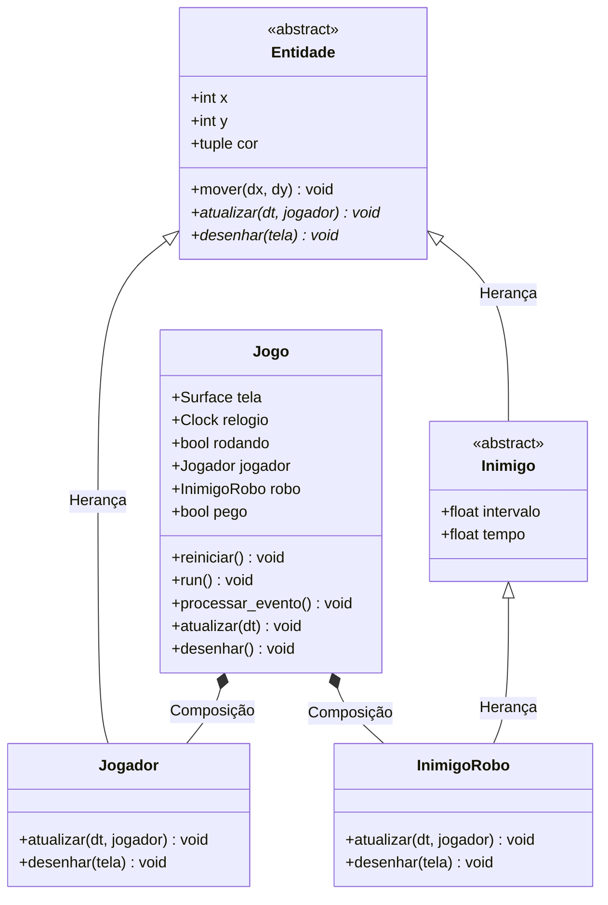

## Protocolo Zero 🤖

Protótipo de jogo 2D desenvolvido em Python com a biblioteca Pygame para a disciplina de Programação Orientada a Objetos (POO).

---

## 🎮 Sobre o Jogo

**Protocolo Zero** é ambientado em um cenário pós-apocalíptico dominado por inteligências artificiais rebeldes. O jogador controla um engenheiro de IA sobrevivente que precisa explorar instalações abandonadas, desviar e combater máquinas hostis e coletar peças fundamentais para montar um computador funcional. O objetivo final é carregar e executar um software capaz de neutralizar o controle das IAs sobre o mundo.

### Mecânicas Principais
- **Exploração:** Movimentação em ambiente 2D com obstáculos e áreas bloqueadas.
- **Sobrevivência:** Gerenciamento de pontos de vida diante de máquinas hostis.
- **Coleta e Inventário:** Busca pelos 5 componentes essenciais:
  - Placa-mãe
  - Processador
  - Memória RAM
  - Armazenamento
  - Fonte de alimentação
- **Condições de Fim de Jogo:**
  - **Vitória:** Reunir as peças, montar o computador e executar o software.
  - **Derrota:** Os pontos de vida do personagem chegarem a zero.

---

## 👥 Equipe de Desenvolvimento

| Integrante | GitHub |
| :--- | :--- |
| Rodolfo Zion Ruthes Brito | [@rodolfozion1719](https://github.com/rodolfozion1719) |
| Pedro Ricardo Moreira | [@pedro-rfm](https://github.com/pedro-rfm) |
| Lucas Viana Gusmão| [@lucasvianagusmao](https://github.com/lucasvianagusmao-dev) |
| Eduardo Moraes de Oliveira | [@Eduardo-moraisOl](https://github.com/Eduardo-moraisOl) |

---

## 🧩 Aplicação dos Conceitos de POO

O projeto foi estruturado com foco na aplicação prática dos pilares da Orientação a Objetos:

- **Encapsulamento:** Atributos críticos (como vida do jogador) são protegidos e manipulados apenas via métodos específicos (`take_damage()`, `heal()`).
- **Abstração:** Classes-base como `Entidade` definem a interface comum (`update()`, `draw()`, `take_damage()`) sem expor detalhes de implementação.
- **Herança:** `Jogador` e `Inimigo` herdam da base `Entidade`. Tipos específicos de inimigos (`InimigoRobo`, `InimigoDrone`) herdam de `Inimigo`.
- **Polimorfismo e Sobrescrita:** Inimigos compartilham a interface `attack()` e `update()`, mas executam comportamentos distintos (combate corpo a corpo vs. disparo de projéteis à distância).
- **Composição:** A classe principal `Jogo` contém a `Fase` atual e a `InterfaceJogo`. O `Jogador` contém o seu `Inventario`.
- **Agregação:** A `Fase` mantém referências ao `Jogador`, inimigos, componentes e obstáculos, permitindo que entidades persistam entre transições.
- **Associação:** Relações de interação direta, como combate entre `Jogador` e `Inimigo`, ou uso dos itens coletados no `Computador`.

---

## 🛠️ Tecnologias Utilizadas

- **Linguagem:** Python 3.10+
- **Biblioteca gráfica:** Pygame

---

## 🚀 Como Executar o Protótipo

### Pré-requisitos
Certifique-se de ter o Python instalado na sua máquina.

### Passo a passo

1. **Clone o repositório:**
   ```bash
   git clone https://github.com/rodolfozion1719/ProtocoloZeroPOO.git
   cd ProtocoloZeroPOO
   ```

2. **Crie e ative um ambiente virtual (recomendado):**
   - **Linux / macOS:**
     ```bash
     python3 -m venv .venv
     source .venv/bin/activate
     ```
   - **Windows:**
     ```bash
     python -m venv .venv
     .venv\Scripts\activate
     ```

3. **Instale as dependências:**
   ```bash
   pip install -r requirements.txt
   ```

4. **Inicie o jogo:**
   ```bash
   python main.py
   ```

---


## 🕹️ Controles e Interface

| Entrada | Ação |
| :--- | :--- |
| **`↑` (Seta para Cima)** | Move 1 célula (40px) para cima |
| **`↓` (Seta para Baixo)** | Move 1 célula (40px) para baixo |
| **`←` (Seta para a Esquerda)** | Move 1 célula (40px) para a esquerda |
| **`→` (Seta para a Direita)** | Move 1 célula (40px) para a direita |
| **`R`** | Reinicia a partida / reposiciona entidades |

> **Nota:** As mensagens de status do jogo e orientações ao jogador são exibidas dinamicamente na barra de título da janela (`pygame.display.set_caption`).

---

## 🎯 Regras e Dinâmica do Protótipo

- **Movimentação Discreta (Grid):** Toda a movimentação ocorre em passos fixos de **40x40 pixels** dentro de uma janela de 800x600 pixels.
- **Limites da Tela:** A classe base `Entidade` valida os limites da janela antes de confirmar o movimento, impedindo que o jogador ou robô saiam da área visível.
- **Inteligência do Robô:** O `InimigoRobo` acumula tempo delta (`dt`) e dá um passo a cada `0.5s`, priorizando a aproximação no eixo horizontal ($X$) e, em seguida, no eixo vertical ($Y$).
- **Detecção de Colisão:** Por ser baseado em coordenadas de grade, o contato ocorre quando `jogador.x == robo.x` e `jogador.y == robo.y`.
- **Condição de Derrota:** Ao colidir, a variável de estado `self.pego` é ativada, bloqueando novos comandos de movimento até que a tecla `R` seja pressionada.

---

## 📐 Modelagem Orientada a Objetos (UML)

O diagrama abaixo representa com fidelidade as classes, atributos, métodos e relações presentes no arquivo `PrototipoSimples.py`:



### Justificativa dos Conceitos de POO Aplicados

1. **Abstração (`Entidade` e `Inimigo`):**
   - A classe `Entidade` define o contrato comum para qualquer elemento gráfico posicionado (`x`, `y`, `cor`), implementando o método concreto `mover(dx, dy)` com barreira de tela e declarando os métodos abstratos `atualizar` e `desenhar`.
   - A classe intermediária `Inimigo` especializa a entidade adicionando controle temporal de passo (`intervalo` e `tempo`), mantendo a herança expansível para novos tipos de inimigos.

2. **Herança e Polimorfismo:**
   - `Jogador` e `InimigoRobo` herdam de `Entidade`, mas possuem comportamentos polimórficos de desenho: o jogador é renderizado como um **retângulo** (`pygame.draw.rect`) e o robô como um **círculo** (`pygame.draw.circle`).
   - O método `atualizar` do `Jogador` é passivo (acionado via teclado no loop de eventos), enquanto o do `InimigoRobo` implementa a rotina de perseguição automática.

3. **Composição e Encapsulamento (`Jogo`):**
   - A classe `Jogo` centraliza e encapsula o ciclo de vida da aplicação (inicialização do Pygame, tratamento de eventos `QUIT`/`KEYDOWN`, atualização por `tick` e renderização no buffer da tela).
   - Ela possui relação de **composição** direta com as entidades ativas (`self.jogador` e `self.robo`), recriando-as no método `reiniciar()`.

---

## 📌 Estado Atual vs. Próximos Passos

- [x] Janela gráfica e game loop a 60 FPS com cálculo de `dt`.
- [x] Movimentação em grade 40x40px com contenção nas bordas da tela.
- [x] Robô com temporizador de passos e lógica básica de perseguição.
- [x] Colisão em grade e bloqueio pós-captura.
- [x] Reinício completo da cena com a tecla `R`.
- [ ] *(Próxima versão)* Inclusão de obstáculos estáticos (`Obstaculo`) bloqueando caminhos.
- [ ] *(Próxima versão)* Adição dos componentes coletáveis de hardware (`Componente`).
- [ ] *(Próxima versão)* Terminal do computador (`Computador`) para validação das peças e vitória.
- [ ] *(Próxima versão)* Barra de vida com dano fracionado e cooldown de ataque.
