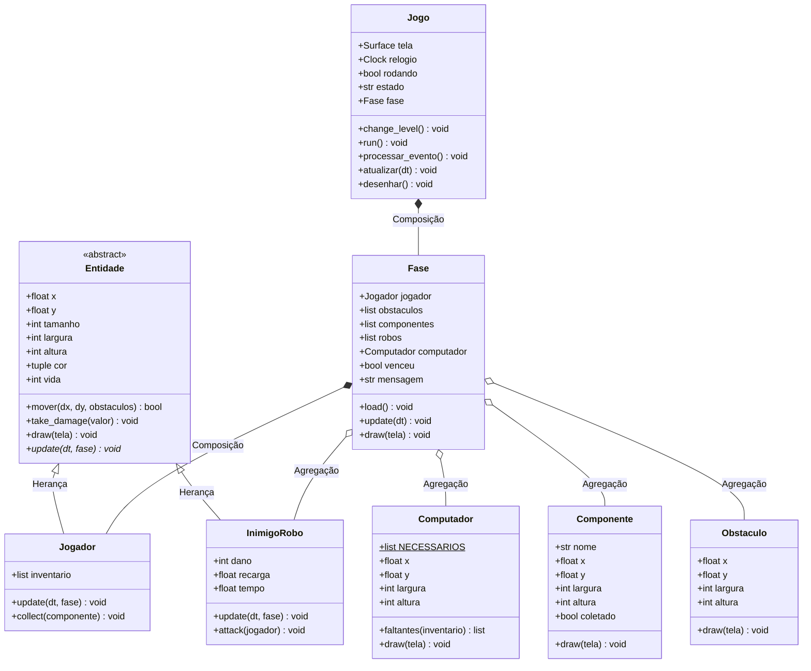

## Protocolo Zero 🤖

Protótipo de jogo 2D desenvolvido em Python com a biblioteca Pygame para a disciplina de Programação Orientada a Objetos (POO).

---

## 🎮 Sobre o Jogo

**Protocolo Zero** é ambientado em um cenário pós-apocalíptico dominado por inteligências artificiais rebeldes. O jogador controla um engenheiro de IA sobrevivente que precisa explorar instalações abandonadas, desviar e combater máquinas hostis e coletar peças fundamentais para montar um computador funcional. O objetivo final é carregar e executar um software capaz de neutralizar o controle das IAs sobre o mundo.

### Mecânicas Principais
- **Exploração:** Movimentação em ambiente 2D com obstáculos e áreas bloqueadas.
- **Sobrevivência:** Gerenciamento de pontos de vida diante de máquinas hostis.
- **Coleta e Inventário:** Busca pelos 5 componentes essenciais:
  - Placa-mãe
  - Processador
  - Memória RAM
  - Armazenamento
  - Fonte de alimentação
- **Condições de Fim de Jogo:**
  - **Vitória:** Reunir as peças, montar o computador e executar o software.
  - **Derrota:** Os pontos de vida do personagem chegarem a zero.

---

## 👥 Equipe de Desenvolvimento

| Integrante | GitHub |
| :--- | :--- |
| Rodolfo Zion Ruthes Brito | [@rodolfozion1719](https://github.com/rodolfozion1719) |
| Pedro Ricardo Moreira | [@pedro-rfm](https://github.com/pedro-rfm) |
| Lucas Viana Gusmão| [@lucasvianagusmao](https://github.com/lucasvianagusmao-dev) |
| Eduardo Moraes de Oliveira | [@Eduardo-moraisOl](https://github.com/Eduardo-moraisOl) |

---

## 🧩 Aplicação dos Conceitos de POO

O projeto foi estruturado com foco na aplicação prática dos pilares da Orientação a Objetos:

- **Encapsulamento:** Atributos críticos (como vida do jogador) são protegidos e manipulados apenas via métodos específicos (`take_damage()`, `heal()`).
- **Abstração:** Classes-base como `Entidade` definem a interface comum (`update()`, `draw()`, `take_damage()`) sem expor detalhes de implementação.
- **Herança:** `Jogador` e `Inimigo` herdam da base `Entidade`. Tipos específicos de inimigos (`InimigoRobo`, `InimigoDrone`) herdam de `Inimigo`.
- **Polimorfismo e Sobrescrita:** Inimigos compartilham a interface `attack()` e `update()`, mas executam comportamentos distintos (combate corpo a corpo vs. disparo de projéteis à distância).
- **Composição:** A classe principal `Jogo` contém a `Fase` atual e a `InterfaceJogo`. O `Jogador` contém o seu `Inventario`.
- **Agregação:** A `Fase` mantém referências ao `Jogador`, inimigos, componentes e obstáculos, permitindo que entidades persistam entre transições.
- **Associação:** Relações de interação direta, como combate entre `Jogador` e `Inimigo`, ou uso dos itens coletados no `Computador`.

---

## 🛠️ Tecnologias Utilizadas

- **Linguagem:** Python 3.10+
- **Biblioteca gráfica:** Pygame

---

## 🚀 Como Executar o Protótipo

### Pré-requisitos
Certifique-se de ter o Python instalado na sua máquina.

### Passo a passo

1. **Clone o repositório:**
   ```bash
   git clone https://github.com/rodolfozion1719/ProtocoloZeroPOO.git
   cd ProtocoloZeroPOO
   ```

2. **Crie e ative um ambiente virtual (recomendado):**
   - **Linux / macOS:**
     ```bash
     python3 -m venv .venv
     source .venv/bin/activate
     ```
   - **Windows:**
     ```bash
     python -m venv .venv
     .venv\Scripts\activate
     ```

3. **Instale as dependências:**
   ```bash
   pip install -r requirements.txt
   ```

4. **Inicie o jogo:**
   ```bash
   python main.py
   ```

---

## 🕹️ Controles

| Tecla | Ação |
| :--- | :--- |
| **`↑` (Seta Cima)** | Move o personagem para cima |
| **`↓` (Seta Baixo)** | Move o personagem para baixo |
| **`←` (Seta Esquerda)** | Move o personagem para a esquerda |
| **`→` (Seta Direita)** | Move o personagem para a direita |
| **`R`** | Reinicia a partida / recarrega a fase |

---

## 🎯 Regras e Dinâmica

- **Objetivo principal:** Encontrar e coletar os 5 componentes de hardware:
  1. *Placa-mãe*
  2. *Processador*
  3. *Memória RAM*
  4. *Armazenamento*
  5. *Fonte*
- **Condição de Vitória:** Com os 5 componentes no inventário, aproxime-se e interaja com o terminal do computador central.
- **Condição de Derrota:** Os robôs patrulham o mapa e perseguem o jogador em intervalos regulares. Cada ataque reduz a vida do jogador em 10 pontos. Se a vida atingir 0, ocorre *Game Over*.
- **HUD Superior:** Exibe a barra de vida em tempo real (200px máx.) e 5 slots indicativos dos componentes coletados (cinza = pendente, verde = coletado).

---

## 📐 Modelagem Orientada a Objetos (UML)

O projeto adota os pilares de **Abstração**, **Herança**, **Encapsulamento** e **Polimorfismo**, além de relações de **Composição** e **Agregação**.



### Justificativa dos Conceitos de POO Aplicados
1. **Classe Abstrata e Polimorfismo (`Entidade`):** Define a base de posicionamento, dimensões, renderização e controle de dano. O método abstrato `update(dt, fase)` força subclasses como `Jogador` e `InimigoRobo` a implementarem suas lógicas comportamentais específicas.
2. **Reaproveitamento de Código via Herança:** O método `mover(dx, dy, obstaculos)` da classe `Entidade` trata as colisões de borda e com obstáculos estáticos tanto para o jogador quanto para os robôs.
3. **Agregação e Composição:** A classe `Fase` atua como agregadora dos elementos do cenário (`Obstaculo`, `Componente`, `Computador`, `InimigoRobo`) e compõe o estado ativo do `Jogador`. A classe `Jogo` encapsula o ciclo de vida do Pygame e os estados de transição da aplicação.

---

## 📌 Estado Atual do Protótipo

- [x] Movimentação em grid com detecção de colisões em paredes e obstáculos.
- [x] Lógica de perseguição dos inimigos com cooldown de ataque.
- [x] Sistema de coleta e inventário de componentes.
- [x] Validação de peças no computador central.
- [x] Telas de vitória e derrota com opção de reinício imediato (`R`).
- [x] HUD superior com status de vida e slots de peças coletadas.
- [ ] *(Versão Final)* Refinamento da máquina de estados e algoritmos de busca de caminho (A* / Breadth-First Search).
- [ ] *(Versão Final)* Adição de efeitos sonoros e tilesets gráficos.
